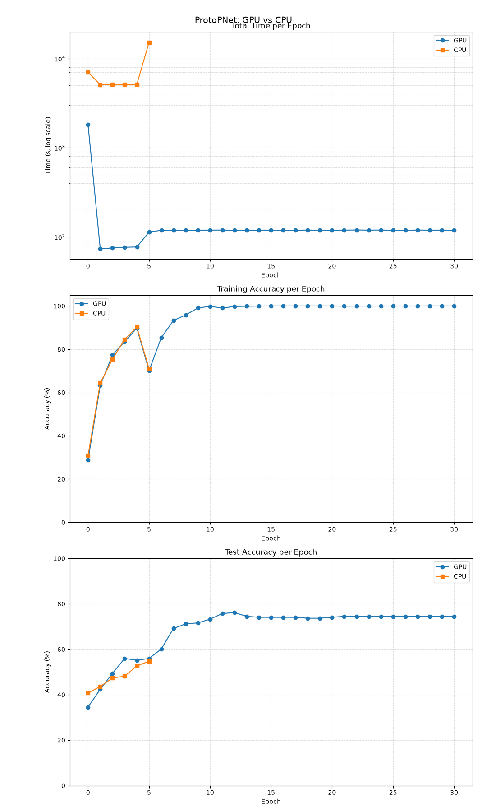

# Lecture-ProtoPNet

This project is a fork of [cfchen-duke/ProtoPNet](https://github.com/cfchen-duke/ProtoPNet). It has been converted into a Jupyter Notebook so that it can be run directly in Google Colab for learning purposes.

## Running in Google Colab

To run the notebook in Google Colab using only CPU, open this link:

- [main_cpu.ipynb](https://colab.research.google.com/github/leputz/Lecture-ProtoPNet/blob/master/main_cpu.ipynb)

To run the notebook in Google Colab with GPU, open this link:

- [main_gpu.ipynb](https://colab.research.google.com/github/leputz/Lecture-ProtoPNet/blob/master/main_gpu.ipynb)

## Requirements

When running the above notebooks, you need to:

- Log in and mount your Google Drive.
- Ensure that your Google Drive has at least approximately **3 GB** of free space for saving the dataset on the first run.

## CPU vs GPU Experiment

The following figure shows an experiment comparing the total running time, training accuracy, and test accuracy per epoch using CPU and GPU, with the following configurations:

- `prototype_shape = (50, 128, 1, 1)`
- `num_classes = 5`
- Other settings: the same as in `settings.py`

